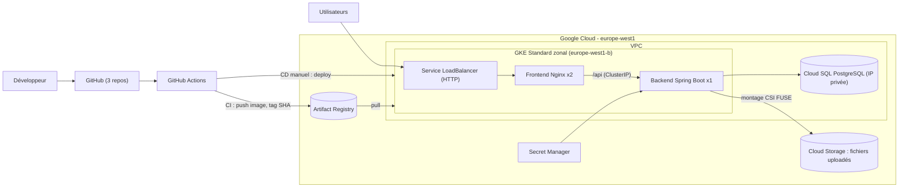

# Design — MediSmart Cloud Deploy (GKE)

> Statut : conception quasi terminée, 25/10/2026. Les points marqués **⏳** restent à faire (recherches, tests, reformulation).
> Les justifications sont des versions de travail : à reformuler avec mes propres mots avant de coder et avant l'entretien.

---

## 1. Contexte et objectif

MediSmart (projet PFA ENIAD) tourne aujourd'hui avec Docker Compose sur un Droplet DigitalOcean. Ce projet le migre vers **Google Cloud (GKE)** avec une chaîne CI/CD et une infrastructure décrite en Terraform.

**Objectif principal :** ce n'est pas de livrer l'application à un client, mais de **prouver à un recruteur, concrètement, les compétences d'un Associate Cloud Engineer (ACE)** : GKE, Artifact Registry, Cloud SQL, Cloud Storage, Secret Manager, IAM, Workload Identity Federation, VPC, dans un projet reproductible et à coût limité.

**Périmètre :** frontend, backend, base de données. **Hors périmètre :** LiveKit (téléconsultation), application mobile Flutter (aucun projet Flutter trouvé dans le workspace, voir décision 9).

---

## 2. Application existante (faits issus de l'audit)

| Composant | Technologie | Port | Remarques |
|---|---|---|---|
| Frontend | Angular 21 + Nginx 1.27 | 80 | Appelle `/api` en relatif ; Nginx fait le proxy vers `medismart-backend:8080` |
| Backend | Spring Boot 3.2.3, Java 21 | 8080 | Context-path `/api`, JWT stateless, Actuator présent |
| Base de données | PostgreSQL (18 en prod, 16 en CI) | 5432 | Base `medismart_db`, migrations Liquibase au démarrage |

**Dépôts :** `frontend-app`, `backend-app`, `medismart-deploy` (Compose actuel). Branche de déploiement actuelle : `dev`.

**Services externes appelés par le backend :** Gmail SMTP (587), Groq (HTTPS), Stripe (HTTPS), LiveKit (hors périmètre).

---

## 3. Architecture cible

**Flux de déploiement :**
- **CI (automatique, repos `frontend-app` et `backend-app`)** : `push` → authentification via Workload Identity Federation (sans clé JSON) → build → push dans Artifact Registry (tag = SHA du commit). Ne dépend pas du cluster.
- **CD (manuel, repo `medismart-cloud-deploy`)** : `workflow_dispatch` avec le tag en paramètre → mise à jour des déploiements GKE, lancé seulement quand le cluster existe.

**Flux utilisateur :** load balancer → Nginx (sert Angular, proxy `/api`) → backend → Cloud SQL (IP privée) et Cloud Storage (monté dans le pod). Les secrets viennent de Secret Manager.

---

## 4. Services GCP et cycle de vie

| Service | Rôle | Coût | Survit au `destroy` ? |
|---|---|---|---|
| Artifact Registry | Stockage des images | Très faible | Oui (socle permanent) |
| Secret Manager | Secrets applicatifs | Très faible | Oui (socle permanent) |
| Bucket d'état Terraform (Cloud Storage) | Stocke l'état Terraform | Très faible | Oui (socle permanent) |
| Workload Identity Federation + comptes de service | Authentification CI | Gratuit | Oui (socle permanent) |
| IP statique réservée | `FRONTEND_URL` connu à l'avance | ⏳ à vérifier (facturée si inutilisée ?) | Oui si négligeable |
| VPC + accès aux services privés | Réseau, couloir privé vers Cloud SQL | Faible | Non |
| GKE Standard (cluster zonal) | Exécution des pods | Heures de nœuds | Non |
| Load balancer | Entrée publique | À l'heure | Non (à supprimer avant le `destroy`) |
| Cloud SQL (IP privée) | Base PostgreSQL | À l'heure | Non |
| Bucket des fichiers uploadés (Cloud Storage) | Fichiers montés dans le pod | Faible | Non (`force_destroy = true`) |

**Piste Terraform :** deux dossiers séparés, un socle permanent (`terraform/foundation`) et un environnement jetable (`terraform/environment`).

**Exigences Terraform liées aux décisions :**
- Activer l'add-on `GcsFuseCsiDriver` sur le cluster Standard (non activé par défaut) et activer Workload Identity Federation for GKE (cluster et pool de nœuds).
- Créer l'accès aux services privés (peering) **avant** Cloud SQL ; au `destroy`, la base doit disparaître **avant** le couloir. ⏳ vérifier dans la doc.
- Lier le compte de service Kubernetes du backend à un compte de service Google avec un rôle IAM minimal sur le bucket.

---

## 5. Décisions

### Décisions prises

| # | Décision | Justification |
|---|---|---|
| A | Cluster **zonal** | Le crédit gratuit GKE ne couvre pas les clusters régionaux (vérifié dans la doc tarifaire) |
| B | Privilégier les services managés GCP | Objectif : démontrer les compétences ACE aux recruteurs |
| C | Cycle « créer, tester, détruire » | Limiter les coûts ; la preuve = captures, vidéo, README reproductible |

### Décisions détaillées

**1. Nombre de réplicas du backend**
- Décision : **1 réplica** pour le backend (stratégie `Recreate`) ; 2 réplicas pour le frontend (sans état).
- Justification : le backend n'est pas stateless : fichiers sur disque local et `@Scheduled` sans verrou. À plusieurs réplicas, un fichier peut devenir introuvable et les rappels partent en double. Corriger cela demande ShedLock et du code de stockage, hors du périmètre d'un projet d'infrastructure. `Recreate` évite deux backends simultanés pendant un déploiement.
- Sacrifice : pas de haute disponibilité du backend, courte coupure à chaque déploiement.
- Amélioration documentée : ShedLock (table de verrou en PostgreSQL) puis plusieurs réplicas ; Job de migration Liquibase séparé (recommandé par l'audit).

**2. PostgreSQL : Cloud SQL, connexion par IP privée**
- Décision : **Cloud SQL pour PostgreSQL**, connecté au cluster par **IP privée** (accès aux services privés dans le VPC).
- Justification : service managé (sauvegardes, patchs, disponibilité), base non exposée à Internet, pratique réseau sur le VPC, pas de conteneur supplémentaire dans le pod. *(à reformuler avec mes mots)*
- Sacrifice : plus de configuration réseau dans Terraform, ordre de création et de suppression à respecter, authentification par utilisateur et mot de passe uniquement (mot de passe dans Secret Manager), base vide à chaque session (jeu de données de démo à recharger), risque de facture si j'oublie le `destroy`.
- Points techniques : suffixe aléatoire (`random_id`) dans le nom d'instance car le nom reste réservé après suppression (⏳ vérifier la durée) ; protection contre la suppression désactivée pour permettre le `destroy` ; l'utilisateur de la base est créé par Terraform (règle l'incohérence `postgre` / `medismart`).

**3. Fichiers uploadés**
- Décision : **Cloud Storage monté dans le pod via le pilote CSI Cloud Storage FUSE**, sans modification du code. Bucket dans l'environnement jetable (`force_destroy = true`), car la base est détruite à chaque session.
- Justification : *(à écrire avec mes mots : pas de modification du code, démonstration de Cloud Storage, IAM et Workload Identity)*
- Sacrifice : comportement non POSIX à tester, sidecar injecté qui consomme de la mémoire sur le nœud, Workload Identity à configurer.
- **Plan B :** PVC (disque persistant) si le montage pose problème. Documenter le problème rencontré dans le carnet de bord.
- Complément : `./tessdata` (OCR) est lu en lecture seule ; il doit être copié dans l'image finale (voir section 9).

**4. ConfigMap ou Secret**
- Règle : valeur non sensible → ConfigMap ; secret ou donnée sensible → Secret (alimenté depuis Secret Manager). Voir section 6.
- ⏳ Mécanisme d'injection depuis Secret Manager à choisir en phase Kubernetes/Terraform.

**5. Exposition publique**
- Frontend public (Service `LoadBalancer`, HTTP), backend en **ClusterIP**, Service nommé `medismart-backend` sur le port 8080 (Nginx fonctionne sans modification).
- Justification : Nginx fait déjà le proxy de `/api`, le navigateur n'atteint jamais le backend directement. Moins d'exposition. IP statique réservée pour connaître `FRONTEND_URL` d'avance.
- Sacrifice : pas de HTTPS (Ingress + certificat géré + domaine). Amélioration : enregistrement DNS A vers l'IP statique.
- Flutter : aucun projet trouvé dans le workspace ; hors périmètre.

**6. Pipelines**
- **CI automatique** (build + push, ne dépend pas du cluster), **CD manuel** (`workflow_dispatch`, tag en paramètre). Aucun lien automatique entre les repos : je saisis le tag moi-même.
- Justification : le cluster est éphémère pour limiter les coûts ; un déploiement automatique échouerait quand il n'existe pas.
- Sacrifice : déploiement non automatique, saisie manuelle du tag. Améliorations : `repository_dispatch`, GitOps (ArgoCD).

**7. Tags d'images**
- **SHA du commit.** Jamais de déploiement via `:latest` ou `:dev`.
- Justification : un tag mutable ne permet ni de savoir quelle version tourne, ni de revenir en arrière, et Kubernetes ne redéploie pas si le texte de l'image ne change pas.
- Sacrifice : tag moins lisible.

**8. Registre d'images**
- **Artifact Registry** (socle permanent). Même plateforme que le cluster, authentification par IAM / Workload Identity Federation, sans identifiants à stocker.
- Sacrifice : stockage facturé au-delà d'un petit quota ; nettoyage des vieilles images à prévoir.

**9. LiveKit**
- **Hors périmètre** : testé uniquement en local. Valeurs factices (`LIVEKIT_URL=ws://livekit-disabled:7880`, clés bidon). `LIVEKIT_API_SECRET` n'a pas de valeur par défaut : toutes les variables LiveKit doivent être fournies.
- Sacrifice : la visioconsultation ne fonctionne pas dans la démo. Amélioration : LiveKit Cloud ou déploiement dédié.
- ⏳ Test local : le backend démarre-t-il avec ces valeurs factices, sans serveur LiveKit ?

**10. Mode du cluster**
- **GKE Standard**, zonal (`europe-west1-b`), 1 nœud `e2-medium`, **nœuds publics** (pas de Cloud NAT).
- Justification : maîtriser le dimensionnement avant de déléguer à Autopilot ; `e2-medium` car un backend Spring Boot demande au moins 512 Mo à 1 Go, sidecar FUSE compris.
- Sacrifice : dimensionnement à ma charge ; exposition réseau plus large. Améliorations : Autopilot, nœuds privés + Cloud NAT.
- ⏳ Optionnel : comparaison chiffrée Standard vs Autopilot dans le calculateur de prix.

---

## 6. Variables d'environnement du backend

Destination proposée, à confirmer en phase Kubernetes.

| Variable | Secret ? (audit) | Destination (ConfigMap / Secret) |
|---|---|---|
| `SPRING_SECURITY_USER_NAME` | Non | ConfigMap |
| `SPRING_SECURITY_USER_PASSWORD` | Oui | Secret |
| `SPRING_DATASOURCE_URL` | Non | ConfigMap (IP privée de Cloud SQL, fournie par Terraform) |
| `SPRING_DATASOURCE_USERNAME` | Sensible | Secret |
| `SPRING_DATASOURCE_PASSWORD` | Oui | Secret |
| `JWT_SECRET` | Oui | Secret |
| `JWT_EXPIRATION_MS` | Non | ConfigMap |
| `FRONTEND_URL` | Non | ConfigMap (IP statique) |
| `OAUTH2_REDIRECT_URI` | Non | ConfigMap |
| `MAIL_USERNAME` | Sensible | Secret |
| `MAIL_PASSWORD` | Oui | Secret |
| `MAIL_FROM` | Sensible | Secret |
| `ATTACHMENTS_DIR` | Non | ConfigMap (chemin du montage FUSE) |
| `GROQ_API_KEY` | Oui | Secret |
| `GROQ_MODEL` / `GROQ_BASE_URL` | Non | ConfigMap |
| `OCR_DATAPATH` / `OCR_LANGUAGE` | Non | ConfigMap |
| `LIVEKIT_URL` | Non | ConfigMap (valeur factice) |
| `LIVEKIT_API_KEY` | Oui | Secret (valeur bidon) |
| `LIVEKIT_API_SECRET` | Oui | Secret (valeur bidon) |
| `STRIPE_SECRET_KEY` | Oui | Secret |
| `STRIPE_PUBLIC_KEY` | Non | ConfigMap |
| `GOOGLE_*` / `FACEBOOK_*` (OAuth, désactivé) | Oui (secrets) | Secret, ou absents tant que l'OAuth est désactivé |

---

## 7. Risques identifiés et traitement

| Risque (audit) | Traitement prévu |
|---|---|
| Fichiers écrits sur disque local | Bucket Cloud Storage monté via CSI FUSE sur `ATTACHMENTS_DIR` ; plan B : PVC |
| `@Scheduled` toutes les minutes (rappels en double avec plusieurs réplicas) | 1 réplica backend + `Recreate`. ShedLock en amélioration |
| Liquibase au démarrage (verrou en base) | 1 réplica, donc pas de démarrage concurrent. Job de migration séparé en amélioration |
| Nginx cible `medismart-backend:8080` | Service Kubernetes nommé `medismart-backend`, port 8080 |
| Pas de probes de santé | `/api/actuator/health` ; readiness et liveness |
| Aucune limite mémoire/CPU, pas d'option JVM | `requests` et `limits` réalistes (backend : au moins 512 Mo à 1 Go, sidecar FUSE en plus) ; option JVM de limite mémoire à étudier |
| CORS `*` avec credentials | Restreindre à l'origine du frontend (IP statique) |
| URLs `localhost` par défaut | `FRONTEND_URL` = IP statique ; `LIVEKIT_URL` = valeur factice volontaire ; tout dans le ConfigMap |
| `depends_on` ne garantit pas la disponibilité de la base | Probes + redémarrage automatique du pod ; ⏳ éventuel init container qui attend la base |
| Headers WebSocket absents dans Nginx | Inutile : LiveKit hors périmètre |
| `tessdata` absent de l'image finale | Copier `tessdata` dans l'image finale du Dockerfile backend (⏳ phase Dockerfile) |

---

## 8. Cycle de vie des coûts

| Toujours actif | Créé à chaque session | À faire avant chaque `destroy` |
|---|---|---|
| Artifact Registry, Secret Manager, bucket d'état Terraform, Workload Identity Federation, IP statique. Coût mensuel : ⏳ **À REMPLIR** après lecture de la page de prix GCP | VPC + accès aux services privés, cluster GKE + nœud, Cloud SQL, load balancer, bucket des fichiers | Supprimer le Service `LoadBalancer` ; vérifier la protection de suppression de Cloud SQL ; vérifier qu'aucune ressource orpheline ne reste |

**Points de vigilance :**
- Les ressources créées par Kubernetes (load balancer) ne sont pas gérées par Terraform : les supprimer avant de détruire le cluster, puis vérifier la facturation le lendemain.
- Cloud SQL est facturé tant qu'il existe, y compris la nuit.
- Le crédit gratuit expire et reste limité : `destroy` après chaque session. Vérifier que le compte est bien en essai gratuit avec crédit.
- Une alerte de budget **prévient, mais n'arrête pas les dépenses** : elle ne remplace pas le `destroy`.
- Alerte de budget GCP : **5 €** (seuils conseillés : 50 %, 90 %, 100 %). À créer dans la console.

---

## 9. Incohérences à vérifier dans le code

- [x] Compte Docker Hub : le Compose utilise `forrestgump59` (frontend) et `mohamedbassar` (backend). Sans objet avec Artifact Registry.
- [x] Version PostgreSQL : 18 en production, 16 en CI. ⏳ choisir la version de Cloud SQL (vérifier les versions supportées).
- [x] `POSTGRES_USER` (`postgre`) ≠ `SPRING_DATASOURCE_USERNAME` (`medismart`) : confirmé par l'audit, aucun script d'initialisation. Sans objet pour GKE : l'utilisateur est créé par Terraform.
- [x] `container_name` : absent du Compose, alors que Nginx cible `medismart-backend`. Réglé par le nom du Service Kubernetes.
- [ ] Rapport PFA : tableau 5.3 (`postgres:18`, `:dev`) vs figure 5.6 (`postgres:16`, `:latest`)
- [ ] Le backend démarre-t-il avec des valeurs LiveKit factices ? (test local)
- [ ] `tessdata` : présent dans l'image finale ? (le Dockerfile actuel ne copie que le jar)
- [ ] La CI backend lance `postgres:16` mais utilise le profil `test` (H2, Liquibase désactivé) : Liquibase n'est jamais testé sur PostgreSQL

---

## 10. Correspondance avec l'ACE

Ouvrir le **guide d'examen officiel ACE** (version du 30/06/2026, quatre sections) et compléter : pour chaque section ou objectif, quel élément du projet le prouve.

| Élément du projet | Compétence GCP démontrée | Section / objectif du guide ACE |
|---|---|---|
| Terraform : VPC, accès aux services privés | Réseau, VPC, IP privée | ⏳ |
| GKE Standard, nœuds, manifests | Déploiement et exploitation de GKE | ⏳ |
| Cloud SQL en IP privée | Bases de données managées | ⏳ |
| Buckets Cloud Storage (fichiers, état Terraform) | Stockage objet | ⏳ |
| Workload Identity Federation, comptes de service, rôles minimaux | IAM et sécurité | ⏳ |
| Secret Manager | Gestion des secrets | ⏳ |
| Artifact Registry + CI/CD | Livraison de conteneurs | ⏳ |
| Alerte de budget, `destroy` systématique | Facturation et maîtrise des coûts | ⏳ |
| Cloud Logging / Monitoring | Observabilité | ⏳ (non couvert pour l'instant : amélioration possible, ex. tableau de bord et alerte) |

---

## 11. Livrables

- [x] Décisions 1 à 10 prises
- [ ] Justifications reformulées avec mes propres mots
- [ ] Tableau de correspondance ACE complété
- [ ] Alerte de budget créée dans la console GCP
- [ ] Schéma d'architecture redessiné par mes soins (`docs/architecture.png`)
- [ ] Repo GitHub `medismart-cloud-deploy` avec l'arborescence vide et un README squelette
- [ ] Projet GCP créé, API activées
- [ ] Compte de service / Workload Identity Federation préparé
- [ ] Un Dockerfile par composant qui build en local

---

## 12. Questions ouvertes

- Durée exacte de réservation du nom d'instance Cloud SQL après suppression ?
- Une IP statique réservée mais inutilisée est-elle facturée ?
- Version PostgreSQL à choisir pour Cloud SQL ?
- Le montage Cloud Storage FUSE se comporte-t-il correctement avec l'écriture par hash du backend ?
- Ordre de suppression Cloud SQL / accès aux services privés au `destroy` ?
- Le backend démarre-t-il sans serveur LiveKit ?
- Coût mensuel du socle permanent ?
